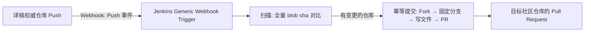

# translator-ci：译稿自动提 PR 服务

译稿权威仓库（GitCode 私有仓库
`Computing_Ecosystem_Docs/Computing_Ecosystem_Docs-EN`）有 Push 时，
由 GitCode Webhook 触发 Jenkins 任务，无人值守地扫描译稿变更并向
对应的目标社区仓库批量提交 Pull Request。



## 工作方式

- **全量对比，自动汇总**：每次运行按译稿当前最新内容与目标仓库
  逐文件比 git blob sha，两次触发之间积累多少个 commit 都只提一个 PR
- **单 commit 提交（幂等）**：同一仓库使用固定分支
  `translator/auto-<目标分支>`，每次以目标分支为基点本地重建该分支——
  全部变更译稿合并为**单个 commit** 后 force push（分支为工具独占，
  重建安全；历史遗留的多 commit 分支也会被强制压缩为单 commit）。
  内容无变化时不强推；目标仓库已存在同一 head/base 的未合并 PR 时
  不重复创建，PR diff 随分支重建自动更新
- **目标路径按仓改写**：个别目标仓库的内容根与源目录结构不同，按
  `index.py` 中的 `TARGET_PATH_RULES` 改写（`CANN/docs` 补 `docs/` 前缀；
  `CANN/release-management` 只有 master 分支、版本号是文件夹，拍平
  `en/` 语言目录并在扩展名前补 `_en` 与中文并存）；未登记的仓库源路径
  原样透传。对比与写入均用改写后的路径，下载译稿仍用源路径
- **Token 规则（权限管控）**：规则文件放在**译稿权威仓库**根目录
  `token_rules.json`，每次运行时读取；配置规则后只处理命中的仓库，
  未配置时全部使用默认 Token
- **开放白名单（范围管控）**：名单文件放在**译稿权威仓库**根目录
  `whitelist.json`，每次运行时读取；名单非空时只处理命中的仓库
  （目录路径相等或前缀匹配），未配置或名单为空时不限制开放范围。
  用于「功能先只对某个仓库开放」这类灰度收口
- **运行期无持久状态**：克隆与临时目录每次运行重建、结束即清，不在
  Jenkins agent 上留缓存；API 只保留 Fork/同步/建 PR 等少量调用，
  目录索引、文件对比、批量写入全部走本地 git（git 协议不受 API 限流约束）

## 部署步骤

### 1. 准备 GitCode 机器人账号与 Token

PR 作者就是 Token 所属账号，请使用机器人账号而非个人账号。Token 需要：

- 默认 Token：对译稿权威仓库有**读权限**，对未命中规则的目标社区仓库有
  Fork/PR 权限
- 规则 Token：对命中的目标社区仓库有 Fork/PR 权限（无需权威仓库读权限）

### 2. Jenkins 侧配置

1. 安装 **Generic Webhook Trigger** 插件
2. 新建 Pipeline 任务，「Pipeline script from SCM」指向本仓库，
   Script Path 填 `Jenkinsfile`
3. 任务配置勾选「This project is parameterized」，添加 **Password Parameter**：
   - Name：`GITCODE_TOKEN`，Default Value：默认 Token
   - 每套规则 Token 再加一个密码参数，参数名与规则文件中的 `token_env`
     一致（如 `GITCODE_TOKEN_MINDSTUDIO`）
   - 密码参数在界面和构建日志中都会打码；参数会自动注入为构建环境变量

### 3. GitCode 侧配置 Webhook

译稿权威仓库 → 设置 → WebHooks → 添加：

```
https://<jenkins地址>/generic-webhook-trigger/invoke?token=translator-auto-pr
```

勾选 **Push 事件**。token 参数值与 Jenkinsfile 中 `GenericTrigger` 的
`token` 一致，可自定义。

### 4. 配置 Token 规则（可选）

在**译稿权威仓库**根目录添加 `token_rules.json`：

```json
{
  "rules": [
    {"keyword": "MindStudio", "token_env": "GITCODE_TOKEN_MINDSTUDIO"},
    {"keyword": "CANN", "token_env": "GITCODE_TOKEN_CANN"}
  ]
}
```

- `keyword`：对译稿目录完整路径（如 `Ascend/26.1.0/MindStudio/msprof`）
  做大小写不敏感的包含匹配，命中第一条规则即生效
- `token_env`：该规则 Token 的环境变量名（Jenkins 凭据注入），
  **Token 本体不写入任何仓库**
- 文件不存在时任务正常运行（全部使用默认 Token）；配置有效规则后，
  未命中规则的仓库一律跳过不处理

新增一套规则 = 规则文件加一行 + 任务配置加一个同名 Password Parameter。

### 5. 配置开放白名单（可选，范围管控）

需要在灰度阶段把功能收口到个别仓库（如「先只对 `sip` 仓库开放」）时，
在**译稿权威仓库**根目录添加 `whitelist.json`：

```json
{
  "repos": [
    "CANN/9.1.0/sip"
  ]
}
```

- `repos`：开放的仓库级目录完整路径（与 `blacklist.json` 同构），
  按「相等或前缀」匹配——条目为仓库级目录时精确命中，条目为高层目录
  （如 `CANN/9.1.0`）时其下所有仓库级目录都放行
- 名单**非空**时只处理命中的仓库，名单外一律跳过（不做对比也不建 PR）；
  文件不存在或名单为空时不限制开放范围，全部仓库正常处理
- 放开更多仓库 = 名单加一行；恢复全量 = 清空（或删除）文件，无需改代码
- 与拉黑名单（`blacklist.json`）同时命中时**拉黑优先**（仍跳过）

### 6. 没有权威仓库权限？用自己的 Fork 做来源

没有权威仓库的管理权限（配不了 Webhook）时，可以把来源指向自己的 Fork：

1. 在 GitCode 上 Fork `Computing_Ecosystem_Docs/Computing_Ecosystem_Docs-EN`
   到自己的账号
2. Webhook 配在 **Fork** 上（设置 → WebHooks → Push 事件），地址同上
3. Jenkins 任务加一个 String Parameter：`GITCODE_SOURCE_REPO`，
   Default Value 填 Fork 的完整路径（如 `myname/Computing_Ecosystem_Docs-EN`）
4. Jenkinsfile 的运行命令加 `--sync-source`：Fork 不会自动跟进上游，
   扫描前先同步，否则对比的是旧内容

注意：Fork 模式下 Webhook 只对「推到 Fork 的提交」触发。生产环境的正道
仍是让权威仓库管理员把 Webhook 加到权威仓库；过渡期可用 Fork +
定时构建（cron）代替 Webhook。

## 本地运行与测试

```bash
pip install -r requirements.txt
export GITCODE_TOKEN=<默认 Token>
python -m translator_ci                 # 全量扫描并提交
python -m translator_ci --keyword msprof  # 按关键字缩小范围（调试）

pip install -e ".[dev]"
python -m pytest -v                     # 运行测试（全部 mock，不触网）
```

## 退出码

| 退出码 | 含义 |
|--------|------|
| 0 | 成功（含「没有变更」） |
| 1 | 运行失败：Token 缺失、规则文件损坏、扫描失败等 |
| 2 | 扫描成功但部分仓库提交失败（Jenkins 判红，逐仓错误见日志） |

## 服务化部署（Docker，替换 Jenkins）

常驻服务模式：GitCode Webhook 直接打到本服务，内存队列合并入队后由唯一
Worker 线程执行扫描/提交，SQLite 落库，自带 Dashboard 监控页面。
默认**影子模式**（只记录、不提 PR），验证通过后运行时切换。

### 快速开始

```bash
cp .env.example .env
# 编辑 .env：至少填 GITCODE_TOKEN、TC_WEBHOOK_TOKEN（TC_ADMIN_TOKEN 可选）
docker compose up -d --build
curl http://localhost:8000/healthz   # {"status":"ok","shadow":true,...}
```

### GitCode Webhook 配置

译稿权威仓库 → 设置 → WebHooks → 添加（勾选 Push 事件）：

```
http://<服务地址>:8000/webhook/gitcode?token=<TC_WEBHOOK_TOKEN 的值>
```

### 单实例约束（硬性）

内存队列 + 全局唯一 Worker + 单 SQLite 连接决定了：

- uvicorn 必须 `workers=1`（Dockerfile CMD 已固定，勿改）
- **不可多副本/水平扩展**，compose 里也不要加 `deploy.replicas`
- 进程崩溃靠 `restart: unless-stopped` + 启动恢复（僵尸 run 标记
  interrupted、比对远端 HEAD 自动补全量扫描）兜底

### 影子模式与切换流程

- 默认 `TC_SHADOW=1`：run 照常克隆、扫描、落库，结果记为
  `would_submit` 而不实际提 PR，用于与 Jenkins 并行验证
- 切换为实际提交（影子开关持久化在 SQLite，重启不丢）：

```bash
curl -X POST http://localhost:8000/api/config/shadow \
  -H "X-Admin-Token: <TC_ADMIN_TOKEN 的值>" \
  -H "Content-Type: application/json" \
  -d '{"enabled": false}'
```

切换时**同时禁用 Jenkins job**（引擎幂等，短暂双跑会收敛），确认稳定后
再删除 GitCode 上的 Jenkins webhook 并归档 Jenkins job。

### Dashboard 与 API

- 浏览器打开 `http://localhost:8000/`：汇总页；`/runs`、`/runs/{id}`、
  `/prs` 为运行记录与 PR 状态页（`/prs` 按 社区 → 仓库 两级 tab 浏览）
- `/settings`：设置页，全部运行期配置都可在此自助修改：
  - **仓库配置**：一个条目配齐一个仓库的启用开关与可选专属 Token。
    只有**添加并启用**的仓库才会在 active 模式下真正创建 PR，未列出
    的一律跳过（默认拒绝）；粒度到仓库（该仓所有分支统一受控）；
    社区/仓库名大小写不敏感（统一按小写存储）。Token 保存在 SQLite，
    只显示掩码不回显明文，优先级高于 Token 规则和默认 GITCODE_TOKEN
  - **Token 规则**（目录关键字 → Token，匹配大小写不敏感、按添加顺序
    取第一个命中；表非空即覆盖来源仓 token_rules.json，为空回退读文件）
  - **拉黑名单 / 开放白名单**（目录路径列表；某类非空即覆盖来源仓
    blacklist.json / whitelist.json，为空回退读文件）

  `TC_ADMIN_TOKEN` 未配置时修改操作无需鉴权（内部工具，默认内网部署），
  配置后需在页面顶部输入 token（仅存浏览器 localStorage）
- 只读 JSON：`/api/summary`、`/api/runs`、`/api/runs/{id}`、
  `/api/runs/{id}/log`、`/api/prs`、`/api/settings/repos`、
  `/api/settings/token-rules`、`/api/settings/path-lists`
- 配置 `TC_DASH_TOKEN` 后页面与只读 API 都需鉴权；留空则放开（默认
  部署在内网/反代后）
- 手动触发（Build Now 替代）：

```bash
curl -X POST http://localhost:8000/api/runs \
  -H "X-Admin-Token: <TC_ADMIN_TOKEN 的值>" \
  -H "Content-Type: application/json" \
  -d '{"full_scan": true}'
```

### 规则 Token 运维

推荐直接在 `/settings` 页配置「Token 规则」（关键字 → Token 值，立即
生效、无需重建容器；表非空即覆盖来源仓 token_rules.json）。

文件方式仍保留：`token_rules.json` 加一行规则后，`.env` 加同名变量
（变量名必须与规则的 `token_env` 一致），然后
`docker compose up -d --build` 重建容器——env 进程级固定，不热加载。
缺失的规则 token 只会告警跳过该规则，不会放大权限。

## 项目结构

```
translator-ci/
├── Dockerfile             # python:3.12-slim + git，uvicorn 工厂模式（workers=1）
├── docker-compose.yml     # env_file + ./data:/data 持久化
├── .env.example           # 全部配置项模板（token 本体不落仓库）
├── Jenkinsfile            # 声明式流水线（Webhook 触发，禁止并发构建）
├── translator_ci/
│   ├── cli.py             # 命令行入口（参数、退出码、stdout 日志）
│   ├── service.py         # 业务编排：规则加载/扫描对比/幂等提交/Token 路由
│   └── client.py          # GitCode REST API v5 客户端
├── webapp/                # 常驻服务（FastAPI）
│   ├── api.py             # create_app(settings)：webhook/Dashboard/API/启动恢复
│   ├── runner.py          # Worker 线程：克隆→扫描→影子门控/逐仓提交→落库
│   ├── prsync.py          # Poller 线程：轮询 open PR 状态
│   ├── db.py              # SQLite 状态层（WAL + 单连接）
│   ├── queueing.py        # 合并队列（latest-wins）
│   ├── config.py          # Settings.from_env()
│   └── templates/         # Dashboard 页面（Jinja2 服务端渲染）
├── tests/                 # pytest 单元测试（全部 mock，不发起真实请求）
├── pyproject.toml
└── requirements.txt
```
