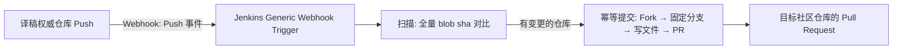

# translator-ci：译稿自动提 PR 服务

译稿权威仓库（GitCode 私有仓库
`Computing_Ecosystem_Docs/Computing_Ecosystem_Docs-EN`）有 Push 时，
由 GitCode Webhook 触发 Jenkins 任务，无人值守地扫描译稿变更并向
对应的目标社区仓库批量提交 Pull Request。



## 工作方式

- **全量对比，多 commit 自动汇总**：每次运行按译稿当前最新内容与目标仓库
  逐文件比 git blob sha，两次触发之间积累多少个 commit 都只提一个 PR
- **幂等提交**：同一仓库使用固定分支 `translator/auto-<目标分支>`；
  与分支现有内容相同的文件跳过写入（不产生空 commit）；目标仓库已存在
  同一 head/base 的未合并 PR 时不重复创建，新变更以新 commit 并入该 PR
- **Token 规则（权限管控）**：规则文件放在**译稿权威仓库**根目录
  `token_rules.json`，每次运行时读取；配置规则后只处理命中的仓库，
  未配置时全部使用默认 Token
- **开放白名单（范围管控）**：名单文件放在**译稿权威仓库**根目录
  `whitelist.json`，每次运行时读取；名单非空时只处理命中的仓库
  （目录路径相等或前缀匹配），未配置或名单为空时不限制开放范围。
  用于「功能先只对某个仓库开放」这类灰度收口
- **无状态**：不 clone 仓库、不依赖本地缓存，Jenkins agent 每次从零运行

## 部署步骤

### 1. 准备 GitCode 机器人账号与 Token

PR 作者就是 Token 所属账号，请使用机器人账号而非个人账号。Token 需要：

- 默认 Token：对译稿权威仓库有**读权限**，对未命中规则的目标社区仓库有
  Fork/PR 权限
- 规则 Token：对命中的目标社区仓库有 Fork/PR 权限（无需权威仓库读权限）

### 2. Jenkins 侧配置

1. 安装 **Generic Webhook Trigger** 插件
2. 新建 Pipeline 任务，「Pipeline script from SCM」指向本仓库，
   Script Path 填 `Jenkinsfile`
3. 任务配置勾选「This project is parameterized」，添加 **Password Parameter**：
   - Name：`GITCODE_TOKEN`，Default Value：默认 Token
   - 每套规则 Token 再加一个密码参数，参数名与规则文件中的 `token_env`
     一致（如 `GITCODE_TOKEN_MINDSTUDIO`）
   - 密码参数在界面和构建日志中都会打码；参数会自动注入为构建环境变量

### 3. GitCode 侧配置 Webhook

译稿权威仓库 → 设置 → WebHooks → 添加：

```
https://<jenkins地址>/generic-webhook-trigger/invoke?token=translator-auto-pr
```

勾选 **Push 事件**。token 参数值与 Jenkinsfile 中 `GenericTrigger` 的
`token` 一致，可自定义。

### 4. 配置 Token 规则（可选）

在**译稿权威仓库**根目录添加 `token_rules.json`：

```json
{
  "rules": [
    {"keyword": "MindStudio", "token_env": "GITCODE_TOKEN_MINDSTUDIO"},
    {"keyword": "CANN", "token_env": "GITCODE_TOKEN_CANN"}
  ]
}
```

- `keyword`：对译稿目录完整路径（如 `Ascend/26.1.0/MindStudio/msprof`）
  做大小写不敏感的包含匹配，命中第一条规则即生效
- `token_env`：该规则 Token 的环境变量名（Jenkins 凭据注入），
  **Token 本体不写入任何仓库**
- 文件不存在时任务正常运行（全部使用默认 Token）；配置有效规则后，
  未命中规则的仓库一律跳过不处理

新增一套规则 = 规则文件加一行 + 任务配置加一个同名 Password Parameter。

### 5. 配置开放白名单（可选，范围管控）

需要在灰度阶段把功能收口到个别仓库（如「先只对 `sip` 仓库开放」）时，
在**译稿权威仓库**根目录添加 `whitelist.json`：

```json
{
  "repos": [
    "CANN/9.1.0/sip"
  ]
}
```

- `repos`：开放的仓库级目录完整路径（与 `blacklist.json` 同构），
  按「相等或前缀」匹配——条目为仓库级目录时精确命中，条目为高层目录
  （如 `CANN/9.1.0`）时其下所有仓库级目录都放行
- 名单**非空**时只处理命中的仓库，名单外一律跳过（不做对比也不建 PR）；
  文件不存在或名单为空时不限制开放范围，全部仓库正常处理
- 放开更多仓库 = 名单加一行；恢复全量 = 清空（或删除）文件，无需改代码
- 与拉黑名单（`blacklist.json`）同时命中时**拉黑优先**（仍跳过）

### 6. 没有权威仓库权限？用自己的 Fork 做来源

没有权威仓库的管理权限（配不了 Webhook）时，可以把来源指向自己的 Fork：

1. 在 GitCode 上 Fork `Computing_Ecosystem_Docs/Computing_Ecosystem_Docs-EN`
   到自己的账号
2. Webhook 配在 **Fork** 上（设置 → WebHooks → Push 事件），地址同上
3. Jenkins 任务加一个 String Parameter：`GITCODE_SOURCE_REPO`，
   Default Value 填 Fork 的完整路径（如 `myname/Computing_Ecosystem_Docs-EN`）
4. Jenkinsfile 的运行命令加 `--sync-source`：Fork 不会自动跟进上游，
   扫描前先同步，否则对比的是旧内容

注意：Fork 模式下 Webhook 只对「推到 Fork 的提交」触发。生产环境的正道
仍是让权威仓库管理员把 Webhook 加到权威仓库；过渡期可用 Fork +
定时构建（cron）代替 Webhook。

## 本地运行与测试

```bash
pip install -r requirements.txt
export GITCODE_TOKEN=<默认 Token>
python -m translator_ci                 # 全量扫描并提交
python -m translator_ci --keyword msprof  # 按关键字缩小范围（调试）

pip install -e ".[dev]"
python -m pytest -v                     # 运行测试（全部 mock，不触网）
```

## 退出码

| 退出码 | 含义 |
|--------|------|
| 0 | 成功（含「没有变更」） |
| 1 | 运行失败：Token 缺失、规则文件损坏、扫描失败等 |
| 2 | 扫描成功但部分仓库提交失败（Jenkins 判红，逐仓错误见日志） |

## 项目结构

```
translator-ci/
├── Jenkinsfile            # 声明式流水线（Webhook 触发，禁止并发构建）
├── translator_ci/
│   ├── cli.py             # 命令行入口（参数、退出码、stdout 日志）
│   ├── service.py         # 业务编排：规则加载/扫描对比/幂等提交/Token 路由
│   └── client.py          # GitCode REST API v5 客户端
├── tests/                 # pytest 单元测试（全部 mock，不发起真实请求）
├── pyproject.toml
└── requirements.txt
```
