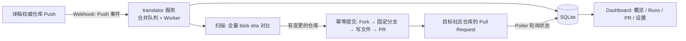

# translator：译稿自动提 PR 服务

译稿权威仓库（GitCode 私有仓库
`Computing_Ecosystem_Docs/Computing_Ecosystem_Docs-EN`）有 Push 时，
GitCode Webhook 直接打到本服务，无人值守地扫描译稿变更并向对应的目标
社区仓库批量提交 Pull Request；自带 Dashboard 监控每次运行与 PR 状态。



## 工作方式

- **全量对比，自动汇总**：每次运行按译稿当前最新内容与目标仓库
  逐文件比 git blob sha，两次触发之间积累多少个 commit 都只提一个 PR
- **单 commit 提交（幂等）**：同一仓库使用固定分支
  `translator/auto-<目标分支>`，每次以目标分支为基点本地重建该分支——
  全部变更译稿合并为**单个 commit** 后 force push（分支为工具独占，
  重建安全）。内容无变化时不强推；目标仓库已存在同一 head/base 的
  未合并 PR 时不重复创建，PR diff 随分支重建自动更新
- **目标路径按仓改写**：个别目标仓库的内容根与源目录结构不同，按
  `translator/index.py` 中的 `TARGET_PATH_RULES` 改写（`CANN/docs` 补
  `docs/` 前缀；`CANN/release-management` 只有 master 分支、版本号是
  文件夹，拍平 `en/` 语言目录并在扩展名前补 `_en` 与中文并存）；
  未登记的仓库源路径原样透传。对比与写入均用改写后的路径
- **Token 规则（权限管控）**：规则文件放在**译稿权威仓库**根目录
  `token_rules.json`，每次运行时读取；配置规则后只处理命中的仓库，
  未配置时全部使用默认 Token。服务模式下推荐改用设置页的
  Token 池 + 仓库配置（见下文），精确到仓库且即时生效。
  两种方式并存，Token 路由优先级：仓库配置引用的命名 Token >
  来源仓 `token_rules.json` 关键字 > 默认 `GITCODE_TOKEN`
- **增量加速**：push 触发携带 before/after sha 时走增量 diff 缩小
  扫描范围；sha 缺失或 diff 失败自动回退全量，宁多勿漏

## 部署（服务模式，推荐）

常驻服务：内存队列合并入队 → 唯一 Worker 线程执行扫描/提交 → SQLite
落库 → Dashboard 展示。默认**影子模式**（只记录、不提 PR），验证通过后
运行时切换。

### 快速开始（Docker Compose）

```bash
cp .env.example .env
# 编辑 .env：至少填 GITCODE_TOKEN、TR_WEBHOOK_TOKEN（TR_ADMIN_TOKEN 可选）
docker compose up -d --build
curl http://localhost:8000/healthz   # {"status":"ok","shadow":true,...}
```

GitCode Webhook 配置：译稿权威仓库 → 设置 → WebHooks → 添加
（勾选 Push 事件）：

```
http://<服务地址>:8000/webhook/gitcode?token=<TR_WEBHOOK_TOKEN 的值>
```

### K8s 部署

清单在 `deploy/k8s/`（Namespace/ConfigMap/PVC/Deployment/Service，
Secret 仅模板需自行生成）。要点：单副本 + `Recreate` 策略 + RWO PVC
挂 `/data`。数据迁移用 SQLite `.backup` 导出后 kubectl cp 进 PVC。

### 运行用户与权限（非 root）

服务以非 root（uid/gid 1000）运行；`/data` 属主不由镜像决定，按部署形态处理：

- **K8s**：Deployment 已设 pod 级 `securityContext`（`runAsNonRoot` /
  `runAsUser` / `runAsGroup` / `fsGroup=1000` + `fsGroupChangePolicy: OnRootMismatch`），
  `fsGroup` 使 PVC 属组归 1000 且组可写；helm chart 需在同一处落实
- **compose（本地）**：绑定挂载 `./data` 的属主由宿主机决定，首次需
  `chown -R 1000:1000 ./data`，否则 SQLite 无法写入
- **`/vault/secrets`**：Vault Agent Injector 注入的 `.env` 默认对 uid 1000 可读；
  应用启动时**直接读取该文件**（不再 `source` 成环境变量），文件存在但不可读时
  启动即失败（fail-fast，不静默以空 token 运行）。若平台 Injector 未把 pod 的
  `runAsUser` 传播到注入容器，可补注解
  `vault.hashicorp.com/agent-run-as-user: "1000"` / `agent-run-as-group: "1000"`

### 凭据读取（不明文进进程环境）

凭据读取顺序为 **secrets 文件 > 环境变量**：`Settings.from_env`、引擎与处理链
统一经 `translator/secrets.py` 取值，优先读 `/vault/secrets/.env`（路径可用
`TR_SECRETS_FILE` 覆盖），文件不存在时回退 `os.environ`。生产（K8s + Vault 注入）
凭据因此**不进入进程环境**，避免经 `/proc/<pid>/environ`、`ps e` 读取或被 git 等
子进程继承；本地/compose 仍沿用 `.env` + `env_file` 方式。

### Web 安全（XSS 加固）

所有响应统一下发安全响应头：`Content-Security-Policy`、`X-Content-Type-Options:
nosniff`、`X-Frame-Options: DENY`、`Referrer-Policy: same-origin`。CSP 取
`default-src 'self'`，脚本仅允许同源 + 每请求 nonce（模板内联 `<script>` 均带该
nonce）；样式因模板使用内联 `style` 保留 `'unsafe-inline'`。`/docs`、`/redoc`、
`/openapi.json`（Swagger UI 依赖 CDN 资源）跳过 CSP。模板变量默认 HTML 转义
（Jinja autoescape），服务端渲染与前端 `esc()` 双重防注入。

### 单实例约束（硬性）

内存队列 + 全局唯一 Worker + 单 SQLite 连接决定了：

- uvicorn 必须 `workers=1`（Dockerfile CMD 已固定，勿改）
- **不可多副本/水平扩展**，compose 里也不要加 `deploy.replicas`
- 进程崩溃靠 `restart: unless-stopped` + 启动恢复（僵尸 run 标记
  interrupted、比对远端 HEAD 自动补全量扫描）兜底

### 影子模式与切换流程

- 默认 `TR_SHADOW=1`：run 照常克隆、扫描、落库，结果记为
  `would_submit` 而不实际提 PR，用于与旧 Jenkins 流水线并行验证
- 切换为实际提交（影子开关持久化在 SQLite，重启不丢）：

```bash
curl -X POST http://localhost:8000/api/config/shadow \
  -H "X-Admin-Token: <TR_ADMIN_TOKEN 的值>" \
  -H "Content-Type: application/json" \
  -d '{"enabled": false}'
```

从 Jenkins 切换时**同时禁用 Jenkins job**（引擎幂等，短暂双跑会收敛），
确认稳定后再删除 GitCode 上的 Jenkins webhook 并归档 Jenkins job。

## Dashboard 与 API

- 浏览器打开 `http://<服务地址>:8000/`：概览；`/runs`、`/runs/{id}`、
  `/prs` 为运行记录与 PR 状态页（`/prs` 按 社区 → 仓库 两级 tab 浏览，
  PR 状态含 CI 标签派生与下一步指引）
- `/settings`：设置页，全部运行期配置都可在此自助修改：
  - **Token 池**：给 GitCode Token 起名保存，一个 token 可复用于多个
    仓库，轮换只改一处；保存在 SQLite，只显示掩码不回显明文
  - **仓库配置**：一个条目配齐一个仓库的启用开关与可选 Token（从
    Token 池下拉选择）。只有**添加并启用**的仓库才会在 active 模式下
    真正创建 PR，未列出的一律跳过（默认拒绝）；粒度到仓库（该仓所有
    分支统一受控）；社区/仓库名大小写不敏感（统一按小写存储）。
    指定 token 后优先于来源仓 token_rules.json 规则和默认 GITCODE_TOKEN

  `TR_ADMIN_TOKEN` 未配置时修改操作无需鉴权（内部工具，默认内网部署），
  配置后需在页面顶部输入 token（仅存浏览器 localStorage）
- 只读 JSON：`/api/summary`、`/api/runs`、`/api/runs/{id}`、
  `/api/runs/{id}/log`、`/api/prs`、`/api/settings/repos`、
  `/api/settings/tokens`
- 配置 `TR_DASH_TOKEN` 后页面与只读 API 都需鉴权；留空则放开
- 手动触发（Build Now 替代）：

```bash
curl -X POST http://localhost:8000/api/runs \
  -H "X-Admin-Token: <TR_ADMIN_TOKEN 的值>" \
  -H "Content-Type: application/json" \
  -d '{"full_scan": true}'
```

- 失败重提：run 详情页对 `submit_failed`/`error` 的仓库结果提供
  「重试」按钮（整 run 也有「重试失败项」），对应
  `POST /api/runs/{id}/retry`（`{path}` 重试单行走关键字扫，不带则
  重试全部失败行）

### run 状态口径

success / **partial**（扫描有 errors 或提交有 failed，非致命）/
failed（致命）/ interrupted（重启僵尸恢复）。排查 partial：run 详情页
仓库结果表的 error/submit_failed 行 + 完整日志（`/api/runs/{id}/log`，
尾部保留 200KB，已脱敏）。

### Token 运维

推荐在 `/settings` 页操作：Token 池保存命名 Token，仓库配置下拉
引用——立即生效、无需重建容器，控制精确到仓库。

文件方式仍保留（批量/兜底）：`token_rules.json` 加一行规则后，`.env`
加同名变量（变量名必须与规则的 `token_env` 一致），然后
`docker compose up -d --build` 重建容器——env 进程级固定，不热加载。
缺失的规则 token 只会告警跳过该规则，不会放大权限。

## CLI / Jenkins 模式（历史）

引擎包可脱离服务单独跑（Jenkinsfile 为 translator-ci 时代的存档参考）：

```bash
pip install -r requirements.txt
export GITCODE_TOKEN=<默认 Token>
python -m translator                   # 全量扫描并提交
python -m translator --keyword msprof  # 按关键字缩小范围（调试）
```

CLI 模式额外支持权威仓根目录的 `whitelist.json`（开放白名单，相等或前缀
匹配）与 `blacklist.json`（拉黑名单，两者同时命中时拉黑优先）——
**均只在 CLI 模式生效**；服务模式的开放范围统一由设置页仓库配置开关
控制（默认拒绝），等价且粒度更细。

没有权威仓库的 Webhook 权限时，可用自己的 Fork 做来源：
`GITCODE_SOURCE_REPO` 指向 Fork 完整路径，CLI 加 `--sync-source`
（Fork 不会自动跟进上游，扫描前先同步）。

退出码：0 成功（含「没有变更」）；1 运行失败；2 部分仓库提交失败。

## 测试

```bash
pip install -e ".[dev]"
python -m pytest -v                  # 全部 mock，不触网
```

## 项目结构

```
translator/
├── Dockerfile             # openEuler 24.03 + git（Python 3.11），uvicorn 工厂模式（workers=1）
├── docker-compose.yml     # env_file + ./data:/data 持久化
├── .env.example           # 全部配置项模板（token 本体不落仓库）
├── Jenkinsfile            # 历史存档（translator-ci 时代），勿用于新部署
├── CLAUDE.md              # AI 助手上手文档（硬性约束、配置约定）
├── translator/            # 引擎包
│   ├── cli.py             # 命令行入口（参数、退出码、stdout 日志）
│   ├── service.py         # 门面导出：规则加载/扫描对比/幂等提交/Token 路由
│   ├── scan.py            # 变更扫描（全量 blob 对比 / 增量 diff）
│   ├── submit.py          # 幂等提交：Fork → 固定分支 → 单 commit → PR
│   ├── rules.py           # token_rules.json / whitelist / blacklist
│   ├── localgit.py        # 目标仓本地浅克隆索引（git 协议，不受 API 限流）
│   ├── index.py           # 目标路径改写规则 TARGET_PATH_RULES
│   ├── client.py          # GitCode REST API v5 客户端
│   └── common.py          # 公共常量（AUTO_BRANCH_PREFIX 等）
├── webapp/                # 常驻服务（FastAPI，前后端一体化）
│   ├── api.py             # create_app(settings)：webhook/Dashboard/API/启动恢复
│   ├── runner.py          # Worker 线程：克隆→扫描→影子门控/逐仓提交→落库
│   ├── prsync.py          # Poller 线程：轮询 open PR 状态
│   ├── prstatus.py        # PR 派生状态（CI 标签 → 状态 + 下一步指引）
│   ├── queueing.py        # push 合并队列（容量 1，latest-wins）
│   ├── db.py              # SQLite 状态层（WAL + 单连接）
│   ├── config.py          # Settings.from_env()
│   ├── rules_cache.py     # 命名 token 路由缓存
│   └── templates/         # Dashboard 页面（Jinja2 服务端渲染）
├── deploy/k8s/            # K8s 清单（单副本 Recreate + RWO PVC）
├── tests/                 # pytest 单元测试（全部 mock，不发起真实请求）
├── pyproject.toml
└── requirements.txt
```
