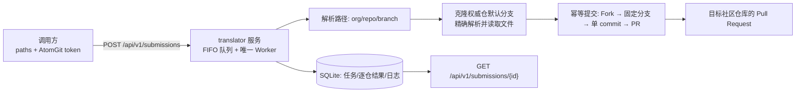

# translator：译稿自动提 PR 服务

调用方通过 HTTP API 提交**目标仓坐标**（组织/仓库/分支/文件相对路径），
服务按权威仓目录布局读取对应译稿内容，向该目标仓库幂等提交 Pull
Request；任务异步执行、逐仓库落库，可通过 API 查询结果与 PR 状态。



## 工作方式

- **路径驱动**：请求体给出目标仓坐标（如
  `Ascend/msagent/26.2.0/docs/en/agent_guide/accuracy.md` 表示提交到
  `Ascend/msagent` 仓的 `26.2.0` 分支、仓内路径
  `docs/en/agent_guide/accuracy.md`），调用方无需了解权威仓目录布局，
  也不用指定版本或分支
- **权威仓路径精确解析**：Worker 克隆权威仓后按组织布局建索引 ——
  `Ascend` 为 `org/产品/版本/仓库/...`，`CANN` 等为 `org/版本/仓库/...`，
  少数仓库本身是顶层目录（如 `Ascend/docs/子产品/版本/...`）；目标坐标
  唯一命中才提交，找不到或命中多个一律整单失败，不做模糊匹配
- **同仓合并**：同一 `(org, repo, branch)` 的多个路径合并为一个 PR；
  全部文件一次校验（任一缺失/超限则整单失败），避免部分 PR 误创建
- **读取与提交分离**：权威仓克隆/读取使用服务侧默认 `ATOMGIT_TOKEN`；
  目标仓 Fork/提交使用调用方请求头 `X-AtomGit-Token`（只存在于请求与
  Worker 内存，永不落库）
- **单 commit 提交（幂等）**：同一仓库使用固定分支
  `translator/auto-<目标分支>`，每次以目标分支为基点本地重建该分支——
  全部变更合并为**单个 commit** 后 force push（分支为工具独占，重建安全）。
  内容无变化时不强推；目标仓库已存在同一 head/base 的未合并 PR 时不重复
  创建，PR diff 随分支重建自动更新
- **内容已在目标分支时**：不创建 PR，回传该目标仓库的分支链接
  （`https://atomgit.com/<org>/<repo>/tree/<branch>`）；`/api/v1/prs/status`
  对这种链接直接回 `state=merged`（`synthetic=true`），调用方据此把任务
  推进到「已上线」，而不是卡在「已提交PR」
- **目标路径按仓改写**：个别目标仓库的内容根与源目录结构不同，按
  `translator/index.py` 中的 `TARGET_PATH_RULES` 改写（`CANN/docs` 补
  `docs/` 前缀；`CANN/release-management` 只有 master 分支、版本号是
  文件夹，拍平 `en/` 语言目录并在扩展名前补 `_en` 与中文并存）；
  未登记的仓库源路径原样透传

## API

服务级鉴权：所有 `/api/v1/*` 端点要求请求头 `X-API-Key`，其值与
`TR_API_KEY` 一致；未配置时服务拒绝启动（fail-closed）。
`/healthz` 无鉴权，供 K8s 探针使用。

### 提交任务

```bash
curl -X POST http://localhost:8000/api/v1/submissions \
  -H "X-API-Key: <TR_API_KEY>" \
  -H "X-AtomGit-Token: <调用方 AtomGit token>" \
  -H "Content-Type: application/json" \
  -d '{"paths": ["Ascend/msagent/26.2.0/docs/en/agent_guide/accuracy.md"],
       "wait": true, "request_id": "release-26.2.0-001"}'
```

- `paths`（必填）：目标仓坐标数组（`组织/仓库/分支/文件相对路径`），
  单次上限 `TR_MAX_PATHS`
- `wait`（可选，默认 false）：在请求内等待任务结束（上限
  `TR_WAIT_TIMEOUT` 秒）；完成返回 200，超时返回 202 + `request_id`
- `request_id`（可选）：调用方幂等键，重复提交同一值直接返回已有任务；
  未传时服务生成 uuid
- `dry_run`（可选，默认 false）：只校验路径与文件大小，不创建 PR，
  结果项记为 `would_submit`
- 队列已满返回 429；路径非法/文件不存在等校验失败记整单 `failed`

### 查询任务

```bash
curl "http://localhost:8000/api/v1/submissions/<request_id>?include_log=true" \
  -H "X-API-Key: <TR_API_KEY>"
```

返回任务状态、逐仓库结果（`submitted` / `already_exists` / `noop` /
`would_submit` / `failed`，含 PR 链接）与可选脱敏日志（尾部保留 200KB）。

### 查询 PR 状态

```bash
# 按 PR 链接
curl "http://localhost:8000/api/v1/prs/status?pr_url=https://atomgit.com/o/r/merge_requests/1" \
  -H "X-API-Key: <TR_API_KEY>"

# 按 org/repo/number
curl "http://localhost:8000/api/v1/prs/status?org=o&repo=r&number=1" \
  -H "X-API-Key: <TR_API_KEY>"

# 按提交任务的 request_id（该任务下的全部 PR）
curl "http://localhost:8000/api/v1/prs/status?request_id=<request_id>" \
  -H "X-API-Key: <TR_API_KEY>"
```

实时直查 AtomGit（不走缓存），返回含 `derived` 派生状态（CI 标签 →
状态与下一步指引）。查询使用服务侧默认 `ATOMGIT_TOKEN`。

例外：`pr_url` 传目标仓分支链接（`.../tree/<branch>`，提交时内容已在
目标分支的情况下回传）时不查 AtomGit，直接返回 `state=merged` 且
`synthetic=true` 的合成状态。

### 任务状态口径

success / **partial**（部分仓库提交失败，非致命）/ failed（校验失败、
全部仓库失败或服务重启中断）。`queued` / `running` 为进行中。

## 部署（服务模式）

常驻服务：FIFO 队列 → 唯一 Worker 线程执行 → SQLite 落库。任务不做合并，
每个请求都有独立结果。

### 快速开始（Docker Compose）

```bash
cp .env.example .env
# 编辑 .env：至少填 TR_API_KEY、ATOMGIT_TOKEN
docker compose up -d --build
curl http://localhost:8000/healthz   # {"status":"ok","queue":0,...}
```

### K8s 部署

清单在 `deploy/k8s/`（Namespace/ConfigMap/PVC/Deployment/Service/Ingress）。
要点：单副本 + `Recreate` 策略 + RWO PVC 挂 `/data`；凭据（`TR_API_KEY`、
`ATOMGIT_TOKEN`）经 Vault Agent Injector 挂载为 `/vault/secrets/.env`
（注解见 Deployment），不进进程环境；对外 HTTPS 由 Ingress（nginx）终结，
证书 Secret `tls-secrets` 由运维经 Vault `domain-tls` 维护（hotopic 同款），
本仓不持有证书材料，域名上线前需运维确认。数据迁移用 SQLite `.backup`
导出后 kubectl cp 进 PVC。

### 运行用户与权限（非 root）

服务以非 root（uid/gid 1000）运行；`/data` 属主不由镜像决定，按部署形态处理：

- **K8s**：Deployment 已设 pod 级 `securityContext`（`runAsNonRoot` /
  `runAsUser` / `runAsGroup` / `fsGroup=1000` + `fsGroupChangePolicy: OnRootMismatch`），
  `fsGroup` 使 PVC 属组归 1000 且组可写；helm chart 需在同一处落实
- **compose（本地）**：绑定挂载 `./data` 的属主由宿主机决定，首次需
  `chown -R 1000:1000 ./data`，否则 SQLite 无法写入
- **`/vault/secrets`**：Vault Agent Injector 注入的 `.env` 默认对 uid 1000 可读；
  应用启动时**直接读取该文件**（不再 `source` 成环境变量），文件存在但不可读时
  启动即失败（fail-fast，不静默以空 token 运行）。若平台 Injector 未把 pod 的
  `runAsUser` 传播到注入容器，可补注解
  `vault.hashicorp.com/agent-run-as-user: "1000"` / `agent-run-as-group: "1000"`

### 凭据读取（不明文进进程环境）

凭据读取顺序为 **secrets 文件 > 环境变量**：`TR_API_KEY` 与引擎
（`ATOMGIT_TOKEN`）统一经 `translator/secrets.py` 取值，优先读
`/vault/secrets/.env`（路径可用 `TR_SECRETS_FILE` 覆盖），文件不存在时回退
`os.environ`。生产（K8s + Vault 注入）凭据因此**不进入进程环境**，避免经
`/proc/<pid>/environ`、`ps e` 读取或被 git 等子进程继承；本地/compose 仍沿用
`.env` + `env_file` 方式。调用方 token 由请求头传入，服务不保存、不回显。

### 单实例约束（硬性）

内存队列 + 全局唯一 Worker + 单 SQLite 连接决定了：

- uvicorn 必须 `workers=1`（Dockerfile CMD 已固定，勿改）
- **不可多副本/水平扩展**，compose 里也不要加 `deploy.replicas`
- 进程崩溃靠 `restart: unless-stopped` + 启动恢复兜底：排队/执行中的任务
  统一标记 `failed`，超过 `TR_SUBMISSION_RETENTION_DAYS` 的历史任务自动清理

## CLI 模式（历史）

引擎包可脱离服务单独跑（CLI 为 translator-ci 时代的历史模式）：

```bash
pip install -r requirements.txt
export ATOMGIT_TOKEN=<默认 Token>
python -m translator                   # 全量扫描并提交
python -m translator --keyword msprof  # 按关键字缩小范围（调试）
```

CLI 模式不读任何规则/名单文件，扫描与提交统一使用默认 `ATOMGIT_TOKEN`。

没有权威仓库的 Webhook 权限时，可用自己的 Fork 做来源：
`ATOMGIT_SOURCE_REPO` 指向 Fork 完整路径，CLI 加 `--sync-source`
（Fork 不会自动跟进上游，扫描前先同步）。

退出码：0 成功（含「没有变更」）；1 运行失败；2 部分仓库提交失败。

## 测试

```bash
pip install -e ".[dev]"
python -m pytest -v                  # 全部 mock，不触网
```

## 项目结构

```
translator/
├── Dockerfile             # openEuler 24.03 + git（Python 3.11），uvicorn 工厂模式（workers=1）
├── docker-compose.yml     # env_file + ./data:/data 持久化
├── .env.example           # 全部配置项模板（token 本体不落仓库）
├── CLAUDE.md              # AI 助手上手指南（硬性约束、配置约定）
├── translator/            # 引擎包
│   ├── cli.py             # 命令行入口（参数、退出码、stdout 日志）
│   ├── service.py         # 门面导出：同步来源/扫描对比/幂等提交
│   ├── scan.py            # 变更扫描（全量 blob 对比 / 增量 diff）
│   ├── submit.py          # 幂等提交：Fork → 固定分支 → 单 commit → PR
│   ├── localgit.py        # 本地浅克隆与文件读取（git 协议，不受 API 限流）
│   ├── index.py           # 目录层级识别与目标路径改写 TARGET_PATH_RULES
│   ├── client.py          # AtomGit REST API v5 客户端
│   ├── secrets.py         # 凭据读取（secrets 文件优先、env 回退）
│   └── common.py          # 公共常量（AUTO_BRANCH_PREFIX 等）
├── webapp/                # 常驻 API 服务（FastAPI）
│   ├── api.py             # create_app(settings)：提交/查询/PR 状态端点
│   ├── paths.py           # 目标仓坐标解析、分组与权威仓路径索引
│   ├── runner.py          # Worker 线程：克隆→校验读取→逐仓提交→落库
│   ├── prstatus.py        # PR 派生状态（CI 标签 → 状态 + 下一步指引）
│   ├── queueing.py        # FIFO 提交队列（有界、不合并）
│   ├── db.py              # SQLite 状态层（任务/结果项/日志）
│   └── config.py          # Settings.from_env()
├── deploy/k8s/            # K8s 清单（单副本 Recreate + RWO PVC）
├── tests/                 # pytest 单元测试（全部 mock，不发起真实请求）
├── pyproject.toml
└── requirements.txt
```
